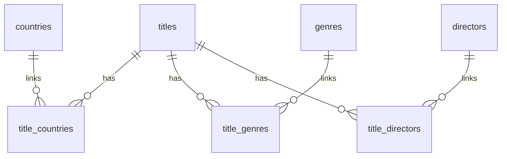

# Netflix Database Entity Relationship Diagram (ERD)

## Overview

This diagram shows the relationships between Netflix titles, countries, genres, and directors in the relational database.

## Table Descriptions

- **titles:** Stores Netflix title details, including type, title, release year, rating, duration, and description.
- **countries:** Stores unique country names.
- **title_countries:** Links titles to their countries.
- **genres:** Stores unique genre names.
- **title_genres:** Links titles to their genres.
- **directors:** Stores unique director names.
- **title_directors:** Links titles to their directors.

## Keys and Relationships

- **PK (Primary Key):** Uniquely identifies a record.
- **FK (Foreign Key):** Connects a record to another table.
- A title can be associated with multiple countries, genres, and directors.
- The linking tables represent these many-to-many relationships.
