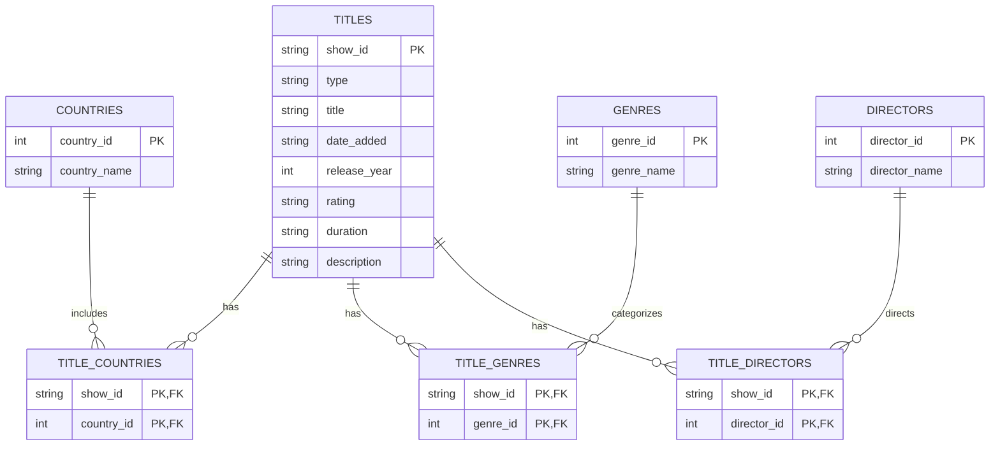

# Netflix ETL Project — Entity Relationship Diagram

This diagram shows how Netflix titles are connected to countries, genres, and directors in the relational database.

## Relationships

- **Titles and Countries:** A title can be associated with multiple countries.
- **Titles and Genres:** A title can belong to multiple genres.
- **Titles and Directors:** A title can have multiple directors.
- **Junction tables:** These connect titles with countries, genres, and directors.
- **Primary keys (PK):** Uniquely identify records.
- **Foreign keys (FK):** Connect related records between tables.
